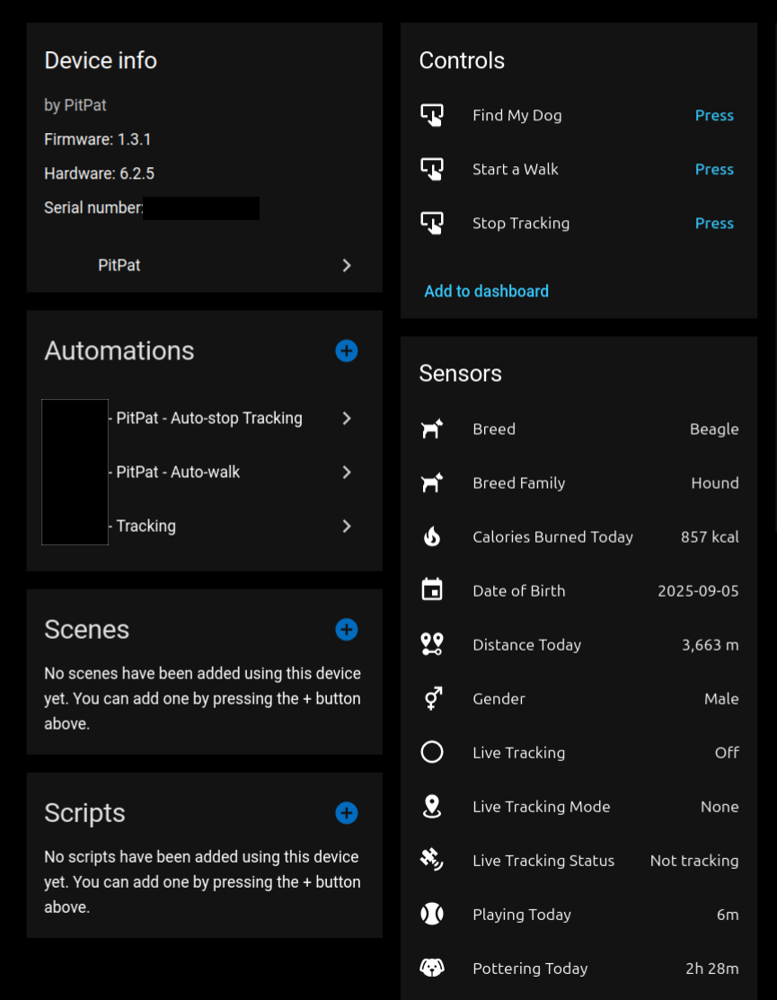
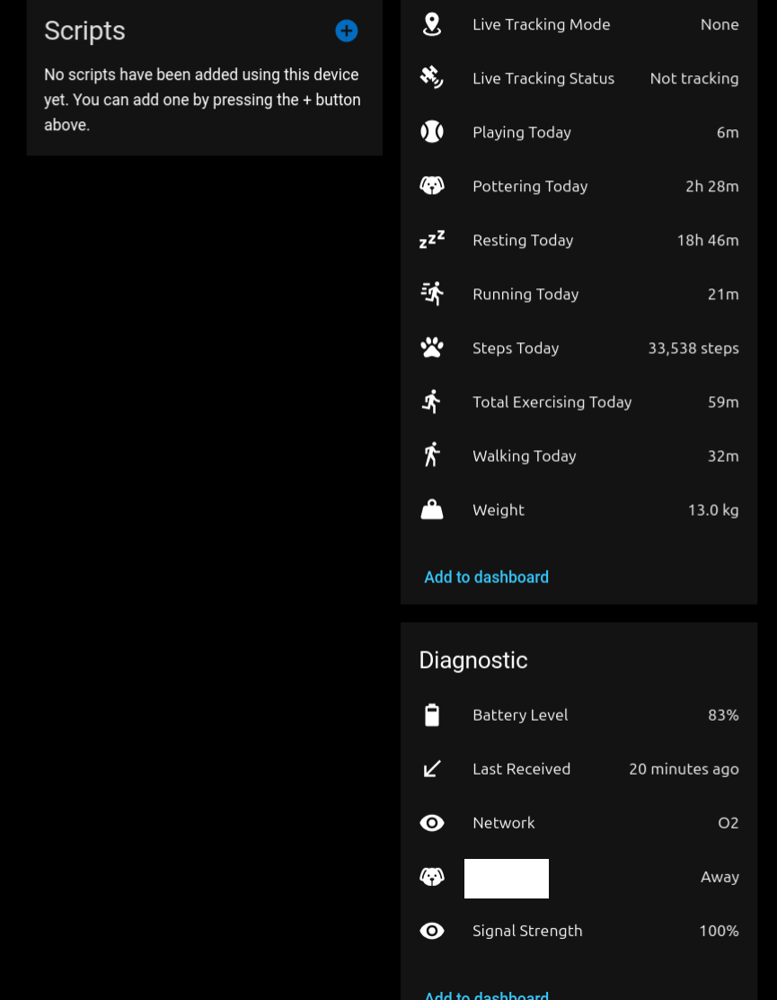

# Home Assistant PitPat Integration

This is a custom integration for Home Assistant to add support for the PitPat pet trackers.

This is in no way endorsed or affiliated with PitPat.

> [!WARNING]
> This integration is experimental.
>
> - Expect bugs caused by limited testing causing unreliable or incorrect data (I only have access to a single device of one type)
> - Expect potentially breaking changes requiring you to re-write scripts and automations
> - A PitPat subscription isn’t required for any of the integration functionality. The integration in some ways is replicating some of the functionality of the pitpat subscription model. Expect it to disappear swiftly if PitPat decide they don’t like this being available and take action.

Some sensors may not be available for your device type. I only have a single GPS device tracker for testing.

## Setup

## Options

### Update Intervals

See [Message Timing](./docs/message-timing.md) for update interval settings.

### Signal Lost

The signal lost timeout is used to determine when a device should show as unavailable, either because it is out of battery or is out of signal range.

Sometime messages are delayed slightly so this setting acts as a buffer. The default of 30 mins allows for a few messages to be missed before the tracker start showing as unavailable.

## Troubleshooting

This is experimental and is a small hobby project. I also only have a single device for testing. If you run into issues, please check the logs and try to diagnose the issue yourself.

If you need to raise an issue, please include logs.

## How can I help?

- Any other investigation into workings of the APIs.
- Investigating any issues you encounter. My testing is fairly limited due to time and only having a single device.
- Reporting issues including any logs.
- Investigating any issues others post.

## Can I fork this?

Sure. I would just ask that you:

- Consider submitting your work as a pull request first,
- If you plan to fork this permanently, include a note to credit my work, and anyone else who has contributed.
