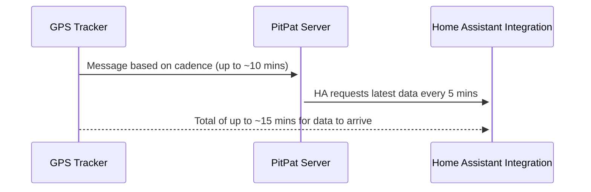

# Message Timing

## On Device Timing

### Battery Life vs Performance (Phone Home Cadence)

PitPat GPS trackers have a feature to prolong the battery life by using a low power mode to track activity, and then "waking" to send the stats to PitPat servers. As a result, the device is only connected for a short period of time to send and receive messages. This can be adjusted to some degree via the device settings:

In the official PitPat app:

1. Open the app page for your pet
2. Tap the picture of your pet at the top of the page
3. Under the "PitPat Device Attached" section, tap "Adjust settings"
4. Change the "Battery life vs Performance" setting

This is also available via this PitPat Home Assistant integration via the "Phone home cadence" select.

The setting is probably (but not necessarily) the same for all GPS trackers. The observed timings for the one I have are:

| Setting | Connection Frequency |
| --- | --- |
| Economy | ~10 mins |
| Standard | ~5 mins |
| Urgent | ~3 mins |

> [!NOTE]
> Remember that this controls how often the device sends **AND** receives messages, and as such, any setting change will take effect from the **NEXT** time it connects.

### Live Tracking

When "Start a walk" or "Find my dog" is used, live tracking will be activated which causes the device to send updates much more frequently. There is a catch that in order to start live tracking, the device has to first receive the command to turn on live tracking. So you can expect a start delay based on the phone home cadency.

The timings for this are a "worst case". For example, if the cadence is set so that the device sends and receives messages every 20 minutes, and the last message was 15 minutes ago, you will only have to wait 5 minutes for live tracking to activate.

## Integration Timing

This integration has it's own delays as it must also poll the PitPat online services to retrieve the data. It would be unreasonable to do this too often, so by default it will request the most recent data every 5 minutes.

In terms of the displayed data, this means that it could be up to 5 minutes behind the PitPat app, however, it is generally not urgent to view activity stats, so this is seen as an acceptable delay. This also has the advantage of the data always being ready in Home Assistant, so opening  the Home Assistant app to view the stats is generally much faster than the official PitPat app.

From v0.12.0, the integration has a separate update interval for when live tracking is enabled which defaults to 60 seconds. This allows more granular and prompt location information.

Use the options cog on the integration page to adjust the intervals, but the defaults should be fine for most:

> [!NOTE]
> When live tracking is started from the integration, the integration polling interval should be updated immediately. If it is updated from elsewhere (e.g. the PitPat app), it will only take effect from the next update.

## How I balance battery life and responsiveness

As the PitPat app indicates, battery life and performance are a trade off of each other. Handily though, typical daily routines mean we can tune the battery life and performance at different times of the day. I use an automation which sets the phone home cadence automatically based on a schedule so that:

- Times when my pet will always indoors, the tracker is in it's lowest power setting.
- Times when we often go for a walk, the tracker is in it's most responsive setting.
- Other times the tracker is in balanced mode in case of a change in routing (e.g. on leave from work)

The automation I use for this is published as a blueprint within this repository:

You will need to set up a Schedule helper for times when the trackers should be in "Economy" mode, and another for "Urgent" mode. Any other time will be set to "Standard" mode.
